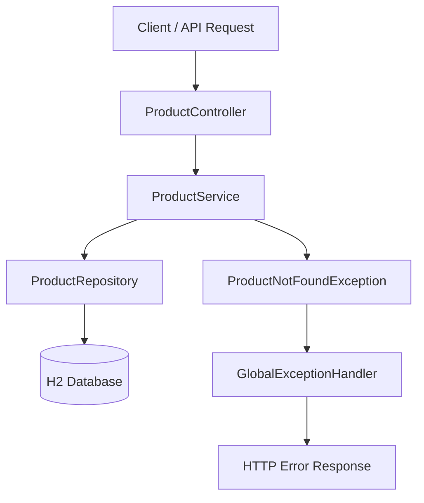

# 🚀 Spring Boot Product Management API

<p align="center">
  **A Clean and Structured RESTful API for Product Management**
</p>

<p align="center">
  
  
  
  
  
</p>

---

## 📌 Overview

**Spring Boot Product Management API** is a lightweight backend application designed to demonstrate the development of RESTful web services using Java and Spring Boot.

The project focuses on building a clean, maintainable, and well-organized backend structure, following common software engineering practices.

It provides a foundation for managing product data through a REST API, with database persistence, separation of responsibilities, and centralized exception handling.

## ✨ Key Features

- **RESTful API:** Backend endpoints for product management.
- **Layered Architecture:** Clear separation between Controller, Service, Repository, and Entity layers.
- **Database Integration:** H2 relational database for product persistence.
- **Spring Data JPA:** Simplified database operations and entity management.
- **Custom Exception Handling:** Dedicated exceptions for handling missing products.
- **Global Exception Handler:** Centralized error handling through `@ControllerAdvice`.
- **Clean Code Structure:** Organized packages and separation of concerns.

## 🏗️ Project Architecture

The application follows a layered architecture to ensure maintainability, readability, and separation of responsibilities.



### Package Structure

```text
src/main/java/gr/demo/productapi/
│
├── controller/
│   ├── ProductController.java
│   └── GlobalExceptionHandler.java
│
├── entity/
│   └── Product.java
│
├── repository/
│   └── ProductRepository.java
│
├── service/
│   ├── ProductService.java
│   └── ProductNotFoundException.java
│
└── ProductApiApplication.java
```

### Layer Responsibilities

| Layer | Responsibility |
|---|---|
| Controller | Handles HTTP requests and API responses |
| Service | Contains business logic |
| Repository | Handles database operations |
| Entity | Defines the Product database model |
| Exception Handler | Centralizes application error handling |

## 🛠️ Technology Stack

| Technology | Purpose |
|---|---|
| Java 17 | Programming language |
| Spring Boot | Backend framework |
| Spring Web | REST API development |
| Spring Data JPA | Data persistence |
| Hibernate | ORM implementation |
| H2 Database | In-memory relational database |
| Maven | Dependency management and build automation |
| IntelliJ IDEA | Development environment |

## 📦 Product Entity

The application uses a `Product` entity to represent product information.

| Field | Type | Description |
|---|---|---|
| id | Long | Automatically generated identifier |
| name | String | Product name |
| price | double | Product price |

The entity is mapped to the `products` database table using JPA annotations.

## ⚠️ Exception Handling

The application includes a dedicated exception-handling mechanism:

- `ProductNotFoundException`: Represents cases where a requested product cannot be found.
- `GlobalExceptionHandler`: Centralizes exception handling using Spring's `@ControllerAdvice`.

This approach keeps error-handling logic separate from the main business logic and makes the application easier to maintain.

## ⚙️ Getting Started

### Prerequisites

Make sure you have installed:

- Java 17 or later
- Maven
- IntelliJ IDEA or another Java IDE

### 1. Clone the repository

```bash
git clone https://github.com/Evita-L/SpringBootSimpleProductProject.git
```

### 2. Navigate to the project directory

```bash
cd SpringBootSimpleProductProject
```

### 3. Run the application

Using Maven:

```bash
mvn spring-boot:run
```

Or run `ProductApiApplication.java` directly from your IDE.

### 4. Access the application

Once started, the application will be available at:

```text
http://localhost:8080
```

## 🎯 Project Goals

This project demonstrates practical experience with:

- Developing RESTful APIs using Spring Boot.
- Implementing layered backend architecture.
- Working with relational databases and JPA.
- Separating business logic from data access.
- Handling application exceptions.
- Structuring maintainable Java applications.

## 🔮 Future Improvements

Potential enhancements include:

- Request validation using Jakarta Bean Validation.
- DTOs for request and response objects.
- Pagination and sorting.
- Unit and integration testing with JUnit and Mockito.
- API documentation with Swagger / OpenAPI.
- Docker containerization.
- Integration with PostgreSQL or MySQL.

## 👩‍💻 Author

**Evita Liakopoulou**

Software Engineer | Java & Spring Boot Backend Development

- GitHub: [Evita-L](https://github.com/Evita-L)
- LinkedIn: [Connect with me](https://www.linkedin.com/)

---

<p align="center">
  **Built with Java & Spring Boot ☕**
</p>
